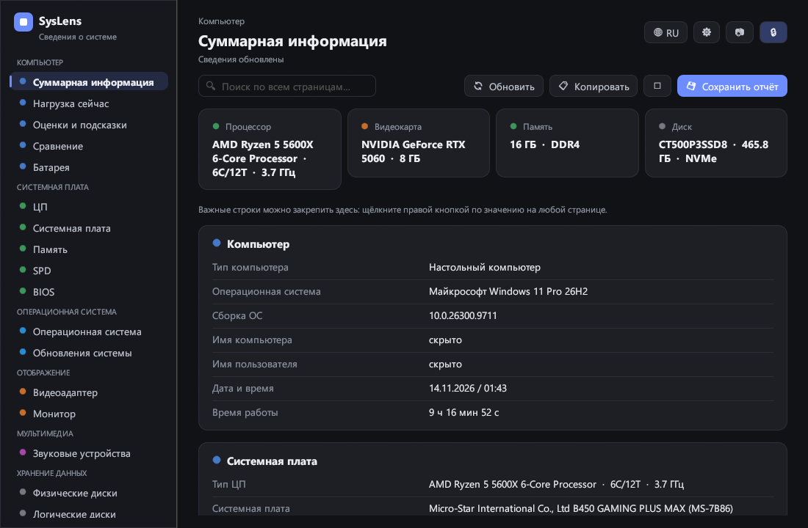

# SysLens

Простая и современная программа для Windows, Linux и macOS, которая показывает,
что стоит в компьютере и что на нём установлено.

Автор — **Foxhand**.



## Что умеет

- **Суммарная информация** — процессор, видеокарта, память и диск на одном экране.
- **Нагрузка сейчас** — процессор (график за минуту и по ядрам), память, скорость
  сети и место на дисках; обновляется каждую секунду.
- **Оценки и подсказки** — простыми словами: что тормозит компьютер («память
  занята на 90 %», «диск почти полон», «один модуль памяти вместо двух»), что
  можно улучшить (свободные слоты памяти, сколько памяти поддерживает плата),
  что давно не обновлялось (BIOS, драйверы, программы, Windows) и готов ли
  компьютер к Windows 11.
- **Сравнение** — откройте JSON-отчёт с другого компьютера и увидите, чем
  отличаются железо и программы.
- **Батарея** — заряд, износ и число циклов (на ноутбуках).
- **Системная плата** — процессор, плата, модули памяти, SPD, BIOS.
- **Операционная система** — версия, сборка, время работы.
- **Отображение** — видеоадаптер и монитор.
- **Мультимедиа** — звуковые устройства.
- **Хранение данных** — физические и логические диски.
- **Сеть** — сетевые адаптеры и адреса.
- **Устройства** — драйверы сторонних производителей, устройства USB, принтеры.
- **Программы** — установленные программы (включая Microsoft Store) с версией,
  издателем, датой и размером, по имени, размеру, дате или издателю;
  автозагрузка; службы с автозапуском.
- **Обновления системы.**
- Шесть языков: русский, English, українська, Deutsch, Español, Polski —
  выбираются кнопкой 🌐 (при первом запуске — по языку системы).
- Поиск по всем страницам сразу, тёмная и светлая тема, скрытие личных данных.
- **Избранное** — щёлкните правой кнопкой по значению и закрепите строку на
  сводной странице.
- Щелчок по значению копирует его; кнопка «Копировать» — всю страницу или
  короткую сводку одной строкой («процессор / видеокарта / память / диск»),
  чтобы вставить в чат.
- Полный отчёт сохраняется куда угодно: текстом, веб-страницей (HTML) или JSON.
- **Печать и PDF** — кнопка с принтером открывает отчёт в браузере с окном
  печати; там же выбирается «Сохранить как PDF».
- **Страница картинкой** — кнопка с фотоаппаратом сохраняет видимую часть
  страницы в PNG; личные данные на картинке скрыты всегда.
- **Значок возле часов** (Windows) — показывает нагрузку процессора и памяти;
  отключается в настройках ⚙.
- **Единицы** — размеры дисков как в Windows (1 ГБ = 1024 МБ) или как на
  коробке (1 ГБ = 1000 МБ), выбор в настройках ⚙.
- **Проверка обновлений** — в настройках ⚙; если вышла новая версия, появится
  кнопка «Скачать новую версию». Сама программа в сеть не ходит, пока вы не
  нажмёте проверку.

Температура, износ и наработка дисков видны, если запустить программу от
имени администратора: обычному пользователю Windows их не отдаёт.

Программе не нужен драйвер и права администратора: в Windows сведения берутся
из стандартных средств (WMI и реестр), в Linux — из `/proc`, `/sys` и обычных
команд (`df`, `ip`, `lspci`).

### Linux

Работает в любом дистрибутиве с графическим окружением (X11 или Wayland).
Без прав root Linux не раскрывает сведения о модулях памяти (SPD), поэтому
эти страницы там короче. Названия видеокарт и сетевых адаптеров точнее,
если установлен `pciutils` (команда `lspci`). Список программ — это
приложения из меню (включая Flatpak и Snap).

### macOS

Сборка для macOS пробная: заполняются основные страницы (компьютер, процессор,
память, система, видеокарта, диски, программы). Программа не подписана,
поэтому при первом запуске её нужно открыть через правую кнопку → «Открыть».

## Как запустить

Со страницы **Releases** скачайте файл для своей системы — установка не нужна:

| Система | Файл |
| --- | --- |
| Windows 10/11, 64-bit | `syslens.exe` |
| Windows на ARM | `syslens-windows-arm64.exe` |
| Linux x86_64 | `SysLens-x86_64.AppImage` (сделать исполняемым и запустить) или `syslens-linux-x86_64.tar.gz` |
| Linux ARM64 | `syslens-linux-arm64.tar.gz` |
| macOS (Intel и Apple Silicon) | `SysLens-macos.zip` |

Через Scoop (Windows):

```
scoop install https://github.com/foxhands/syslens/releases/latest/download/syslens.json
```

Про winget, подпись программы и остальное — в [docs/distribution.md](docs/distribution.md).

Клавиша **F5** обновляет сведения.

## Как собрать самому

1. Установите Rust: <https://rustup.rs>
2. В папке проекта выполните:

   ```
   cargo build --release
   ```

3. Готовая программа: `target/release/syslens.exe` (в Linux — `target/release/syslens`).

В Linux для сборки нужны пакеты разработки окна и графики, например в Ubuntu/Debian:

```
sudo apt install build-essential libxkbcommon-dev libwayland-dev libx11-dev libxcursor-dev libxrandr-dev libxi-dev libgl1-mesa-dev
```

Проверки: `cargo test`.

### Полезные параметры запуска

- `--page apps` — открыть сразу нужную страницу (`summary`, `cpu`, `board`,
  `memory`, `spd`, `bios`, `os`, `gpu`, `monitor`, `audio`, `pdisk`, `ldisk`,
  `net`, `apps`, `live`, `advice`, `compare`, `battery`, `updates`, `drivers`,
  `usb`, `printers`, `startup`, `services`).
- `--report файл.html` — сохранить отчёт без окна и выйти; вид файла — по
  расширению (`.txt`, `.html`, `.json`). Работает вместе с `--private` и `--lang`.
- `--screenshot файл.png` — сделать снимок окна и закрыть программу.
- `--private` — сразу скрыть личные данные (то же, что кнопка с замком).
- `--lang en` — язык интерфейса (`ru`, `en`, `uk`, `de`, `es`, `pl`).
- `--units decimal` — размеры дисков как на коробке (`binary` — как в Windows).
- `--compare отчёт.json` — сразу открыть сравнение с отчётом другого компьютера.

## Личные данные

Кнопка с замком 🔒 скрывает имя компьютера, имя пользователя, серийные
номера, MAC- и IP-адреса — на экране, в скопированной странице и в отчёте.
Удобно, когда вы делитесь снимком или отчётом.

В части JSON-отчёта, по которой сравниваются компьютеры, этих сведений нет
никогда, а в короткой сводке одной строкой — только названия железа и системы.

## Лицензия

MIT — см. файл [LICENSE](LICENSE).
